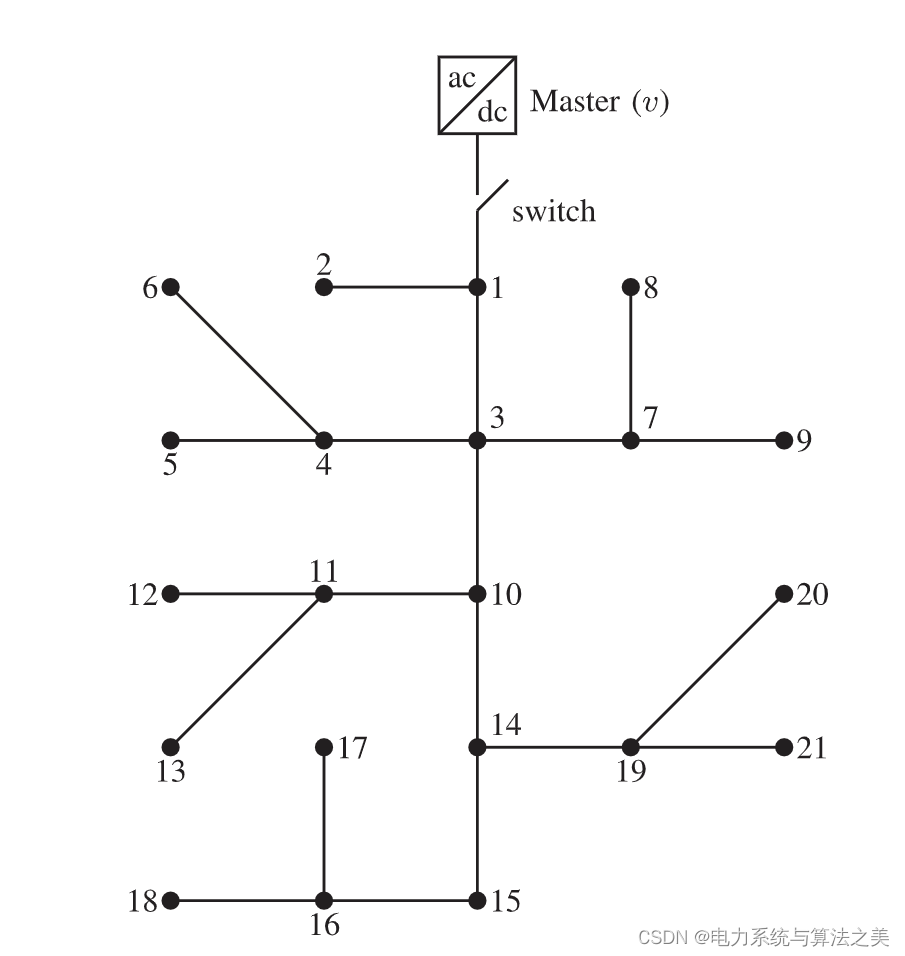
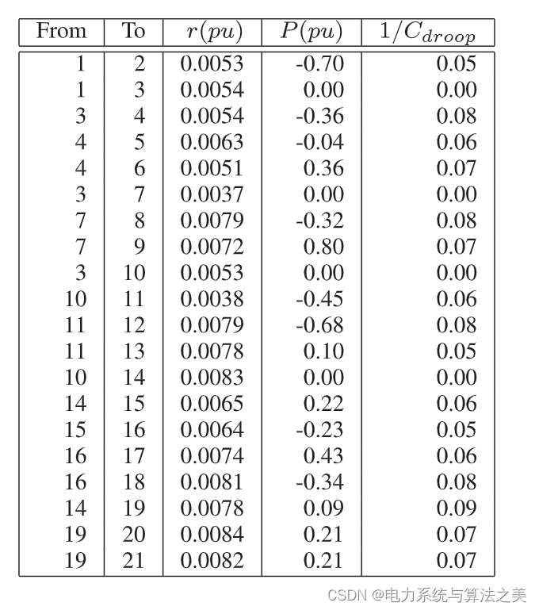
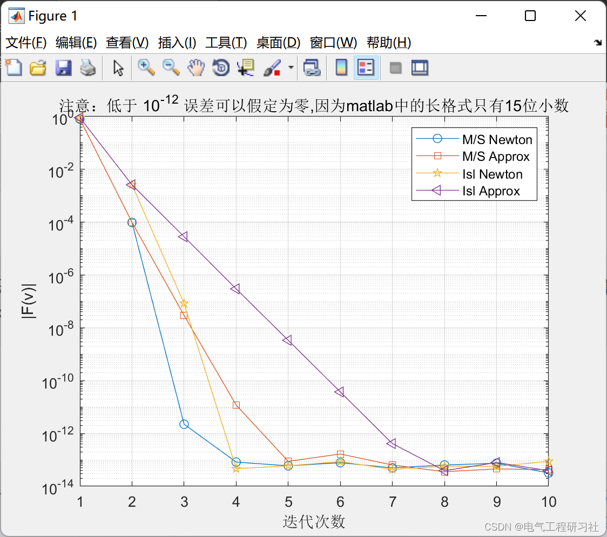
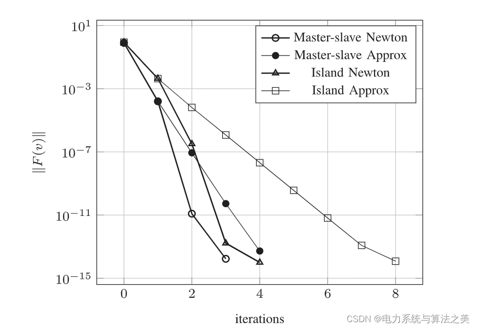
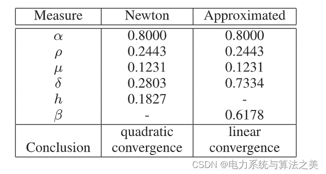
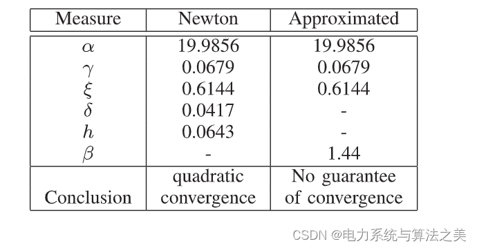
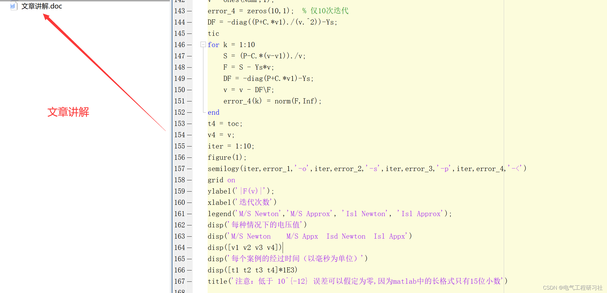

# Newton Method-Based DC Microgrid Flow Study (Matlab Code Implementation)

Editing:
📋📋📋This article's table of contents is as follows: ⛳️⛳️⛳️​Table of Contents 1. Overview 1.1 Current in DC grids 1.2 Innovations and related work 1.3 Organization of the article 2 Mathematics/Network Models 2.1 Master-slave operation 2.2 Island operation 3 Newton's method 4 Cases and MATLAB code implementation 4.1 Examples 4.2 Implementation results 4.3 Analysis 5 MATLAB code and article explanation 6 Concluding remarks 1. Overview The current flow problem is a nonlinear issue that requires the application of Newton's method to solve for a DC microgrid with constant power terminals. This paper proposes sufficient conditions for the second convergence of Newton's method in such grids. Classical Newton's method and its approximations are analyzed both in master-slave and island operations, including the use of voltage regulation. The requirements for convergence starting from near 1 pu voltage and the existence and uniqueness of solutions are proposed. Computational results complement this theoretical analysis.
Microgrids are expected to play a fundamental role in the future concept of smart grids. Especially, DC microgrids are gaining increasing attention due to their advantages in efficiency, reliability, and controllability. DC microgrids can achieve high efficiency and simplify control without reactive power or frequency control; they can also ensure high reliability due to their ability to operate in islanding mode; and since many power generation and storage technologies are already DC (such as solar photovoltaic power generation, batteries), they can be easily integrated. Moreover, most household appliances can adapt to DC operation. In a typical DC microgrid, power electronic converters can operate either as constant current or constant power.In the latter case, the grid model becomes nonlinear and requires a power flow algorithm for static state analysis. This problem is nonlinear/nonconvex and needs to be solved with numerical algorithms. Of course, since the nature of the problem is nonlinear, the convergence of such algorithms is not always guaranteed. An algorithm may even diverge or tend towards an unrealistic solution.
Therefore, It is necessary to establish precise conditions. To determine the exact conditions for the convergence of the power flow algorithm to a unique and realistic solution. On the other hand, There are two main control methods for DC microgrids. This includes master-slave control and downflow control.
In master-slave control, the converter fixes the voltage across the entire grid; this is the most common operation for microgrids connected to the main grid. For islanding mode operations, power in the grid is modified through adroit control to achieve a stable equilibrium point. Both operational modes require a flow algorithm. It is important to note that there is linearization in AC grids, also known as DC power flow. This name comes from the analogy between angles in AC grids and voltages in a linear DC grid. This article does not relate to these types of analogies or linearization. Due to the presence of power converters, we are interested in actual DC and non-linear grids.1.1 Current in DC power grids
The current in DC microgrids shares some similarities with the AC situation, hence we mentioned related work in the literature review below. However, there are some important distinctions worth highlighting: Firstly, the problem still exists in the real number set, allowing the use of real numbers instead of complex numbers for analysis (for example, please note that DC equations are analytical, while AC equations are not). Secondly, the grid can operate as an island (i.e., without relaxation nodes), thus it is necessary to include voltage regulation control in the current problem.Thirdly, the DC grid possesses characteristics that do not exist in its corresponding AC grid. For example, editing is always dominated by diagonal elements, whereas editing is monotonic (please note that an AC grid with high capacitive effects may have editing dominated by diagonals that are not present). Therefore, the flow analysis in a DC microgrid cannot be inferred from the AC situation.
1.2 Innovation Points and Related Work
In this paper, we analyze the convergence of Newton's method and its approximate version in the context of direct current microgrids for power flow. This analysis is important for two main reasons: firstly, power flow algorithms must be executed multiple times during the operation and planning of the microgrid. In operation, ensuring convergence in an intelligent grid environment with less human supervision is an ideal characteristic. In planning, power flow may be part of other algorithms, especially in heuristic optimization problems. Therefore, the quadratic convergence and uniqueness of solutions are key conditions. Secondly, power flow provides the equilibrium points of the dynamic model of the grid. Finding equilibrium is the first step in most studies related to the dynamics and stability of microgrids.
Recently, we analyzed the convergence of the Gaussian-Seidel method in master-slave operations. Here, we prove this result by defining the exact conditions for convergence of Newton's method in master-slave and islanded operations. Additionally, we analyzed the convergence of an approximate Newton method. This method is similar to the fast decoupling of load flow in AC grids. We used Kantorovich's theory for the former and shrinkage mapping theory for the latter. Although these theories are classic results in practical analysis, no one has previously used them to analyze these issues. As expected, Newton's method has quadratic convergence, although within a small attractor, while the approximate Newton method has a guaranteed linear convergence.
1.3 Organization of the Paper The rest of the paper is organized as follows: Section 2 describes the power grid models in master-slave and islanded operations. Section 3 analyzes Newton's method, and Section 4 analyzes the approximate Newton method. Following that, numerical simulations are conducted, and conclusions and references are drawn.
2 Mathematical/Network Model 2.1 Master-Slave Operations See Part 5
2.2 Island Operations See Part 5
4 Cases and Matlab Code Implementation The parameters are given in Table I. Node 1 is voltage controlled. Node 3, 7,  10 and 14 are stepping nodes (thus eliminated by Kron). Experiments show that Assume that A2 is easily satisfied in our test system (i.e., |Pm ax| < 1/ρ = 40.9 pu).
Editor
Figure 3.21: DC microgrid with 21 nodes
Table 1 - Proposed parameters for the proposed testing system
Editor
This is because a well-designed DC microgrid has smaller resistance values to achieve high efficiency. The power flow is calculated in four scenarios: using Newton's method and its approximation, master-slave operation, and islanding operation (meaning the switches in scenario 3 are open). 4.2 Implementation Results
4.3 Analysis
The value of ||F(vk)|| is given in Figure 4 for each iteration. We can observe that the first iterations of Newton's method and its approximate version are identical. However, as the algorithm progresses, the error of Newton's method is shown in Figure 1. Table II summarizes convergence measures for master-slave operations, while Table III summarizes convergence measures for island and master-slave operations, both showing a reduction to quadratic levels, whereas the error of the approximate Newton's method linearly decreases. This behavior aligns with propositions 1 to 4; in fact, these conclusions drawn from numerical simulations can be directly applied using these prepositions. Tables II and III summarize these results. It is important to note that the conditions proposed in this paper are sufficient but not necessary. Therefore, our results are conservative yet realistically bounded by convergence limits.This means that, if conditions are met, we can guarantee the convergence of the method. However, if certain conditions are not met, it does not mean that the algorithm will diverge. This is the case for an approximate Newton method used in island operations, which does not meet the conditions of Proposition 4 (see Table III) in our example, but as we see in Figure 4, the algorithm achieves convergence.
Figure 4. Errors as iterative functions
Table II: Summary of convergence measures for master-slave operations
Editor
Table III: Summary of convergence measures for operations within islands
Editor
5 Matlab code and article explanation This article only showcases a portion of the code, with full code and explanation available in:
error_4 = zeros(10,1);  % Only 10 iterations\nDF = -diag((P+C.*v1)./(v.^2))-Ys;        \ntic\nfor k = 1:10\n    S = (P-C.*(v-v1))./v;\n    F = S - Ys*v;\n    DF = -diag(P+C.*v1)-Ys;\n    v = v - DF\F;\n    error_4(k) = norm(F,Inf);\nend\nt4 = toc;\nv4 = v;\niter = 1:10;\nfigure(1);\nsemilogy(iter,error_1,'-o',iter,error_2,'-s',iter,error_3,'-p',iter,error_4,'-<')\ngrid on\nylabel('|F(v)|');\nxlabel('Iteration count')\nlegend('M/S Newton','M/S Approx', 'Isl Newton', 'Isl Approx');\ndisp('Voltage values for each situation')\ndisp('M/S Newton    M/S Appx  Isd Newton  Isl Appx')\ndisp([v1 v2 v3 v4])\ndisp('The duration of each case (in milliseconds))')\ndisp([t1 t2 t3 t4]*1E3)\ntitle('Note: Below 10^{-12} Errors can be assumed to be zero.,BecausematlabThe long format only15Decimal point')\n  
6. References to theoretical literature are included in the final section, and if any infringement occurs, please contact the blogger for removal.

## Images

<!-- PAYMENT_BLOCK -->

## Get this dataset

- Payment link (Stripe): [Buy now](https://buy.stripe.com/3cs8yP7sY87d0vu9AB)
- Payment QR code: 

<!-- /PAYMENT_BLOCK -->
